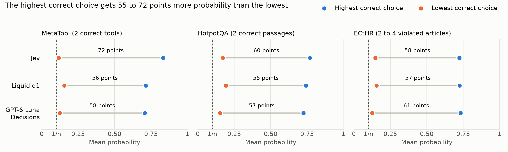

# When Multiple Choices Are Correct: Asymmetric Probability Allocation in Jev and Other Decision Models

[](https://arxiv.org/abs/2610.29217)
[](LICENSE)

**Paper:** [arxiv.org/abs/2610.29217](https://arxiv.org/abs/2610.29217) ([PDF](https://arxiv.org/pdf/2610.29217), [HTML](https://arxiv.org/html/2610.29217)) by Rushab Munot, 2026. This repository holds the code and the instructions sent to the models. The version of the paper is tagged [`arxiv-v1`](https://github.com/Rushab1/gr-jev/tree/arxiv-v1).

## What the paper studies

Decision models such as Jev (TypeSafe AI), Liquid d1 and GPT-6 Luna Decisions (OpenAI Decisions API) take a query and a list of choices. They return one probability per choice. The probabilities of a list sum to 1. TypeSafe and OpenAI suggest a probability threshold to select several choices. In an example in TypeSafe's documentation, a support ticket goes to a second team when the model gives that team a probability above 0.25.

Many tasks have several correct choices. An agent can need two tools. A question can need two supporting passages. A court case can violate three articles. A threshold can select exactly the correct choices only if each correct choice gets a higher probability than every distractor. The paper measures how the three models split probability between the correct choices of one list.



Over the lists with several correct choices, the chart gives the mean probability of the highest correct choice and of the lowest correct choice. The highest correct choice gets 55 to 72 percentage points more than the lowest. The lowest correct choice gets 0.12 to 0.19 on average. A uniform split over the n choices of a list gives each choice 1/n, which is 0.1 for a list of 10. The MetaTool results average 10 permutations of each list. The ECtHR results average 10 cyclic permutations of each list.

## Findings

- **Identical copies.** Five identical copies of one correct choice should get the same probability. The highest copy gets 17 to 79 percentage points more than the lowest copy. Liquid d1 and GPT-6 Luna Decisions predict the copy in the first position in 76% to 98% of their answers.
- **Ranked lists.** In lists where every correct choice gets a higher probability than every distractor, a correct choice still gets less than 1/n in 28% to 46% of the lists.
- **Thresholds.** The best single threshold for a dataset selects exactly the correct choices in 34% to 64% of the examples. On lists of 10 choices, that threshold is between 0.02 and 0.08.
- **Human disagreement.** On ChaosNLI, 100 annotators voted on each example. When the vote shares of the two labels with the most votes differ by less than 0.1, the models' probabilities for those two labels differ by 0.58 to 0.77 on average.

## Models and datasets

| Models | Datasets |
|---|---|
| Jev `jev-1.13.0` (TypeSafe AI API) | MetaTool, tool selection with 2 correct tools |
| Liquid d1 `liquid/d1` (Vercel AI Gateway) | HotpotQA, supporting passages of a question |
| GPT-6 Luna Decisions `openai/gpt-6-luna-decisions` (Vercel AI Gateway) | ECtHR, articles violated in a case |
| | ChaosNLI, votes of 100 annotators on SNLI, MNLI and αNLI |

## Reproduce

```
uv sync
source .venv/bin/activate
cp .env.example .env   # add TYPESAFE_API_KEY and VERCEL_GATEWAY_API_KEY
python scripts/data/download_data.py metatool
python scripts/data/process_data.py metatool
python scripts/run/run_experiment.py copied --dry-run
```

Python 3.13. `--dry-run` prints the number of model calls without sending any request. `scripts/paper/` writes the tables and figures of the paper from `results/`. `AGENTS.md` describes every script and the layout. The saved model responses are not in the repository.

## Citation

```bibtex
@misc{munot2026multiple,
  title         = {When Multiple Choices Are Correct: Asymmetric Probability Allocation in Jev and Other Decision Models},
  author        = {Munot, Rushab},
  year          = {2026},
  eprint        = {2610.29217},
  archivePrefix = {arXiv},
  primaryClass  = {cs.AI},
  url           = {https://arxiv.org/abs/2610.29217}
}
```

## Keywords

decision models, Jev, TypeSafe AI, System One, Liquid d1, GPT-6 Luna Decisions, OpenAI Decisions API, probability allocation, calibration, expected calibration error, probability threshold, multiple correct answers, multi-label selection, tool selection, tool retrieval, MetaTool, HotpotQA, ECtHR, ChaosNLI, position bias, identical choices, annotator disagreement

## License

MIT. See [LICENSE](LICENSE). TypeSafe's customer agreement does not allow training a model on Jev output.
