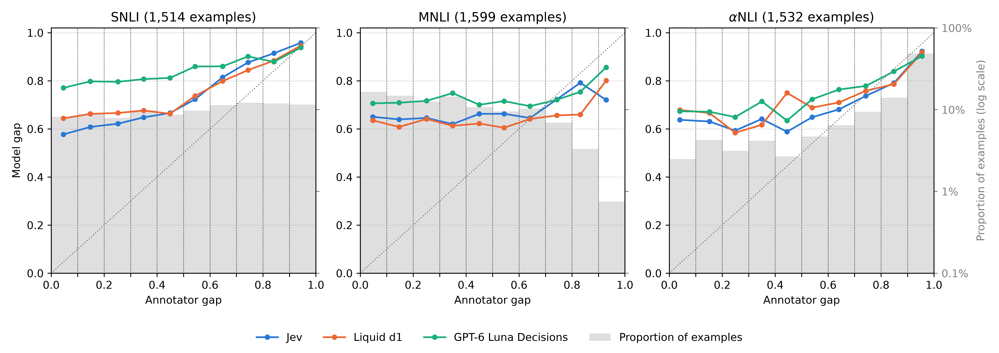

# ChaosNLI: model probabilities against the shares of 100 annotators

Runs of 2026-10-21 on every example of ChaosNLI, on Jev, Liquid d1 and GPT-6 Luna Decisions. The paper reports them in the results (`tab:chaosnli`, `fig:annotator-gap`) and in the calibration appendix (`tab:calibration-annotators`).

## Question

The paper reports that the models put most of the probability on one choice when several choices are correct. A reviewer can answer that the reference of 1/n is arbitrary. ChaosNLI (Nie, Zhou and Bansal, 2020) gives a measured reference that is not 1/n. Each example has the share of 100 annotators who chose each label.

The share of a label measures how much the annotators disagree. It is not the probability that the label is correct.

## Data

| Test file | Examples | Choices | Query |
|---|---:|---:|---|
| `snli` | 1,514 | entailment, neutral, contradiction | A premise and a hypothesis |
| `mnli_m` | 1,599 | entailment, neutral, contradiction | A premise and a hypothesis |
| `alphanli` | 1,532 | 2 hypotheses, each named by its text | Two observations |

The files come from the Hugging Face dataset `earino/chaosnli` at revision `bf8d66a`, a copy of the ChaosNLI release. The Dropbox link of the ChaosNLI repository returned a web page on 2026-10-21. ChaosNLI is licensed CC BY-NC 4.0. `python scripts/data/download_data.py chaosnli` and `python scripts/data/process_data.py chaosnli chaosnli_alpha` build the datasets `chaosnli` and `chaosnli_alpha`.

## Requests

The `own` experiment sends the labels of every example in every cyclic order, all orders in one request. SNLI and MNLI have 3 orders and alphaNLI has 2.

- SNLI and MNLI. The state is "Premise: ..." and "Hypothesis: ..." on two lines. The instruction is "Choose how the hypothesis relates to the situation or event in the premise." The choices are entailment ("The hypothesis is definitely correct about the situation or event in the premise."), neutral ("... might be correct ...") and contradiction ("... is definitely incorrect ..."). The wording follows the prompt that MNLI gave the annotators who wrote the hypotheses (Williams et al., 2018, Figure 1).
- alphaNLI. The state is "Observation 1: ..." and "Observation 2: ..." on two lines. The instruction is "Choose the more plausible hypothesis of what happened between the two observations." It follows Bhagavatula et al. (2020), who asked people to "choose the more plausible hypothesis".

The runs made 4,645 Jev calls and 4,645 calls to each gateway model. No model refused or rejected a list. The input tokens cost $0.35 for the three models. The results folders are `results/chaosnli_own*/2026-10-21_01` and `results/chaosnli_alpha_own*/2026-10-21_01`.

Before these runs, a script outside the repository sent 100 MNLI examples in one order with other descriptions of the labels.

## Measures

- The Jensen-Shannon distance of Nie et al. (2020) between the annotators' shares and the probabilities of an answer, with the natural logarithm. A uniform distribution over the labels gives the reference.
- The share of answers whose highest probability is on the label with the most votes, and on the label of the source dataset.
- The entropy of the probabilities and of the shares, in bits, and their highest value.
- The annotator gap is the share of the label with the most votes minus that of the second label. The model gap is the absolute difference between the probabilities of the same two labels. The gap chart puts the examples in ten bins of width 0.1 by annotator gap.
- The ECE against the shares puts every label in one of ten bins of width 0.1 by its probability. It averages the distance between the mean probability and the mean share of each bin, weighted by the number of labels in the bin.
- Each answer to one order of the labels counts once.

## Results

For every model and test file, the entropy of the probabilities is below that of the shares. Where the annotator gap is below 0.1, the mean annotator gap is 0.04 to 0.05 and the mean model gap is 0.58 to 0.77. The ECE against the shares is 9 to 22 percentage points. The highest probability is on the label with the most votes in 57% to 86% of the answers.

`python scripts/report/annotator_figures.py` prints the tables below from the results folders. `python scripts/report/annotator_charts.py --gap docs/annotator_gap.png --reliability docs/annotator_reliability.png` draws the two charts. The code is in `src/grjev/annotators.py` and `src/grjev/annotator_charts.py`, and the runs are `ANNOTATOR_RUNS` in `src/grjev/constants.py`.

### snli

| Model | Examples | Answers, one per order of the labels | Jensen-Shannon distance from the annotators | Answers on the label with the most votes | Answers on the label of the source dataset | Entropy of the probabilities (bits) | Entropy of the shares (bits) | Highest probability | Highest share |
|---|---:|---:|---:|---:|---:|---:|---:|---:|---:|
| Chance (Nie et al., 2020) | -- | -- | 0.38 | 0.54 | 0.45 | -- | -- | -- | -- |
| RoBERTa-large (Nie et al., 2020) | -- | -- | 0.22 | 0.79 | 0.75 | -- | -- | -- | -- |
| Jev | 1,514 | 4,542 | 0.21 | 0.83 | 0.71 | 0.42 | 0.80 | 0.87 | 0.75 |
| Liquid d1 | 1,514 | 4,542 | 0.21 | 0.79 | 0.73 | 0.46 | 0.80 | 0.87 | 0.75 |
| GPT-6 Luna Decisions | 1,514 | 4,542 | 0.28 | 0.76 | 0.62 | 0.27 | 0.80 | 0.92 | 0.75 |

### mnli_m

| Model | Examples | Answers, one per order of the labels | Jensen-Shannon distance from the annotators | Answers on the label with the most votes | Answers on the label of the source dataset | Entropy of the probabilities (bits) | Entropy of the shares (bits) | Highest probability | Highest share |
|---|---:|---:|---:|---:|---:|---:|---:|---:|---:|
| Chance (Nie et al., 2020) | -- | -- | 0.30 | 0.46 | 0.45 | -- | -- | -- | -- |
| RoBERTa-large (Nie et al., 2020) | -- | -- | 0.31 | 0.64 | 0.67 | -- | -- | -- | -- |
| Jev | 1,599 | 4,797 | 0.29 | 0.61 | 0.65 | 0.60 | 1.07 | 0.81 | 0.65 |
| Liquid d1 | 1,599 | 4,797 | 0.28 | 0.57 | 0.65 | 0.72 | 1.07 | 0.79 | 0.65 |
| GPT-6 Luna Decisions | 1,599 | 4,797 | 0.32 | 0.59 | 0.60 | 0.53 | 1.07 | 0.85 | 0.65 |

### alphanli

| Model | Examples | Answers, one per order of the labels | Jensen-Shannon distance from the annotators | Answers on the label with the most votes | Answers on the label of the source dataset | Entropy of the probabilities (bits) | Entropy of the shares (bits) | Highest probability | Highest share |
|---|---:|---:|---:|---:|---:|---:|---:|---:|---:|
| Chance (Nie et al., 2020) | -- | -- | 0.32 | 0.51 | 0.51 | -- | -- | -- | -- |
| RoBERTa-large (Nie et al., 2020) | -- | -- | 0.21 | 0.84 | 0.85 | -- | -- | -- | -- |
| Jev | 1,532 | 3,064 | 0.15 | 0.86 | 0.84 | 0.32 | 0.41 | 0.90 | 0.88 |
| Liquid d1 | 1,532 | 3,064 | 0.15 | 0.86 | 0.85 | 0.31 | 0.41 | 0.91 | 0.88 |
| GPT-6 Luna Decisions | 1,532 | 3,064 | 0.17 | 0.86 | 0.85 | 0.29 | 0.41 | 0.91 | 0.88 |

## Limits

- The share of the annotators is not the probability that a label is correct. A reviewer can say that a model asked for one label has no duty to reproduce the disagreement. The providers describe the outputs as probabilities, and the paper's introduction states that.
- SNLI, MNLI and alphaNLI are public since 2015, 2018 and 2020, and ChaosNLI since 2020. They may be in the training data of the three models.
- Every SNLI and MNLI example of ChaosNLI has the source `agree_3`: 3 of its 5 original annotators chose the majority label. Examples on which the annotators disagree are therefore more frequent than in SNLI or MNLI as a whole.
- One wording of the labels per dataset, and one request per example.
